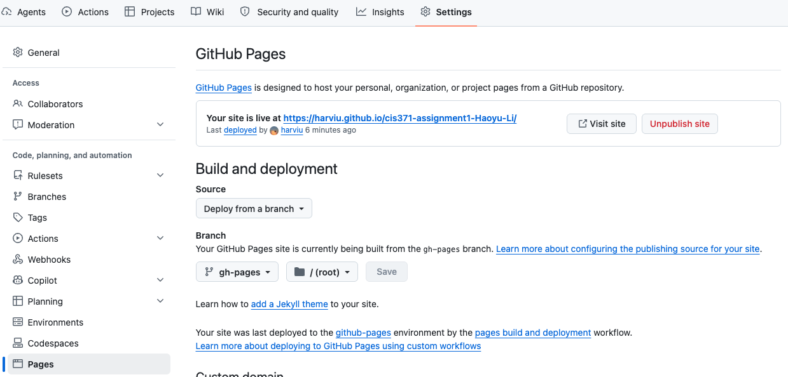

# Beverage Maker

— SCSS + TypeScript

In this assignment, you will build a small interactive “Beverage Maker” web app using **TypeScript** and **Sass (SCSS)**. The page includes a mug graphic and several option groups (temperature, base beverage, syrup, cream). Your job is to complete the missing SCSS mixin and finish the TypeScript functions so the UI updates correctly when the user changes options.

## Objectives

By completing this assignment, you will practice:

- SCSS Mixins: Refactor repeated styles into an SCSS mixin and reuse it with `@include`.
- DOM Events: Use `addEventListener("change", ...)` to react to radio button selection changes.
- DOM Manipulation: Update element classes and styles to reflect user choices.
- CSS Variables: Use CSS custom properties (for example `--syrup-color`) to connect TypeScript state to CSS styling.

## Preparation

Follow the IDE, environment, GitHub, and repository setup as you did in lab 1. As a reminder, you can find the instructions on [lab 1 page](css-html.md). Use the [Assignment 2 template](https://github.com/harviu/cis371-assignment2).

## Instructions

### Task 1: SCSS mixin in `src/style.scss`

In `src/style.scss`, you will see a `.syrup` style block that contains a repeating linear gradient with a hard-coded color (for example `#ffefd5`).

Refactor this syrup styling into a mixin:

- Create an SCSS mixin named `syrup-layer`.
- The mixin must accept one parameter: the stripe color (for example `$color`).
- Replace the hard-coded color in the gradient with `$color`.
- Update `.syrup` to use the mixin via `@include`.

Goal: changing the syrup stripe color should require changing only one argument, without copying the gradient code.

### Task 2: Syrup behavior in `src/main.ts`

Complete the following functions:

```ts
function applySyrup(input: HTMLInputElement): void {
  // TODO: implement this function
}

function setupSyrupListeners(): void {
  // TODO: implement this function
}

setupSyrupListeners();
```

**`applySyrup` behavior:**

- When the user selects a syrup option, update the syrup layer in the mug.
- Use the `syrups` color map (provided in starter code) to look up the selected syrup color.
- Set CSS variable `--syrup-color` on the `.syrup` element so SCSS can use it. For how to set a CSS variable in JavaScript, please refer to the following documentation: [https://developer.mozilla.org/en-US/docs/Web/CSS/Guides/Cascading_variables/Using_custom_properties](https://developer.mozilla.org/en-US/docs/Web/CSS/Guides/Cascading_variables/Using_custom_properties)

**`setupSyrupListeners` requirements:**

- Add `"change"` event listeners to all syrup radios: `input[name="syrup"]`.
- On page load, apply the initial syrup state using the currently checked radio.

### Task 3: Temperature, cream, and base behavior in `src/main.ts`

Complete the following functions:

```ts
function setupCreamListeners(): void {
  // TODO: implement this function
}
setupCreamListeners();

function setupTemperatureListeners(): void {
  // TODO: implement this function
}
setupTemperatureListeners();

function setupBaseListeners(): void {
  // TODO: implement this function
}
setupBaseListeners();
```

Required behavior:

#### Temperature

- Add `"change"` listeners to `input[name="temperature"]`.
- When a temperature radio changes, call the provided `applyTemperature(input)` function.
- On page load, call `applyTemperature()` once using the currently checked temperature radio.

#### Cream

- Add `"change"` listeners to `input[name="cream"]`.
- When a cream radio changes, call the provided `applyCream(input)` function.
- On page load, call `applyCream()` once using the currently checked cream radio.

#### Base beverage

- Add `"change"` listeners to `input[name="base"]`.
- When a base radio changes, call the provided `applyBase(input)` function.
- On page load, call `applyBase()` once using the currently checked base radio.

#### Expected Outcome

- [Expected Outcome Demo](https://harviu.github.io/BeverageMaker-Expected/)

## Grading Rubric

| Category                                                |  Points |
| ------------------------------------------------------- | ------: |
| GitHub setup, commits, push, & GitHub Pages deployment  |      15 |
| Task 1: SCSS mixin (syrup-layer) in src/style.scss      |      25 |
| Task 2: Syrup functions in src/main.ts                  |      25 |
| Task 3: Cream + Temperature + Base listeners in main.ts |      25 |
| Code quality & organization                             |      10 |
| **Total**                                               | **100** |

## Deliverables

- Deploy your web application using the following commands in your `terminal`:

  ```bash
   npm run build
   npm run deploy
  ```

- Github Pages Setup
  - Set up your GitHub repository for GitHub Pages deployment. Follow the steps shown in the image below: .
  - Your web application will be accessible at the URL: `https://[GITHUB_ID].github.io/[YOUR_REPO]/`

- Submit the URL of your GitHub Pages in Blackboard.
